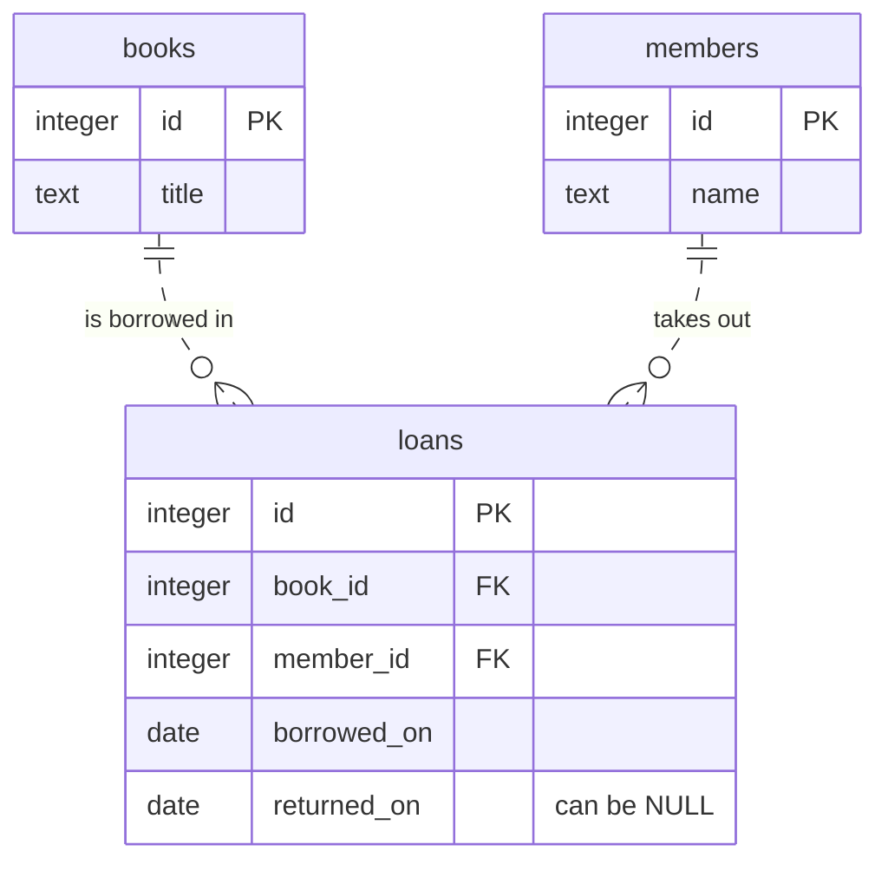

# Session 03 — Create tables, read rows, and change data

[Week 02](README.md) · [SQL reference](notes.md) · [Open postgres.new](https://postgres.new/)

## What we’ll learn

- Tables, rows, and columns
- `CREATE TABLE` and column types
- Primary keys and foreign keys
- `SELECT`, `INSERT`, `UPDATE`, and `DELETE`

## Start with the facts

If Ali borrows *The Hobbit* and the library app restarts, what facts does the library need to keep? It has a copy of *The Hobbit*. Ali is a member. Ali borrowed that copy on January 12. If someone else borrows it later, we keep the same book record and add a new loan record.

| Word | What it means here |
|---|---|
| Database | The collection of library data and its structure. |
| Table | A collection of one kind of record, such as books. |
| Row | One record, such as one physical copy of a book. |
| Column | One named part of a record, such as `title`. |
| Schema | The definitions of the tables, columns, and rules. |
| SQL | The language we use to tell PostgreSQL what to create, read, or change. |

Open a fresh database in postgres.new. Run each statement as you reach it. The [complete setup script](code/library.sql) is available if you need to start over in a new database.

## 1. Create the `books` table

```sql
CREATE TABLE books (
    id integer PRIMARY KEY,
    title text NOT NULL
);
```

| Syntax | How to read it |
|---|---|
| `CREATE TABLE` | Create a table. These are SQL keywords. |
| `books` | Give the table the name `books`. |
| `(` and `)` | Enclose the column definitions and any table rules. |
| `id integer` | Create a column named `id` that holds whole numbers. Write its **name** first and its **type** second. |
| `PRIMARY KEY` | Identify each row by this column. Each value must be present and unique within this table. |
| `title text NOT NULL` | Create a text column named `title` and require a value. |
| `,` and `;` | A comma separates definitions. The semicolon ends the statement. |

Two copies can have the same title and different IDs. We’ll choose small IDs by hand so it’s easy to trace the examples. [Creating a table](https://www.postgresql.org/docs/current/tutorial-table.html) · [Constraints](https://www.postgresql.org/docs/current/ddl-constraints.html)

## 2. Insert books and read them back

```sql
INSERT INTO books (id, title)
VALUES
    (1, 'The Hobbit'),
    (2, 'A Wizard of Earthsea'),
    (3, 'The Little Prince');
```

`INSERT INTO` names the destination. `(id, title)` sets the order in which we supply the values. `VALUES` introduces the rows. Each pair of parentheses after `VALUES` holds one row. Single quotes mark text values.

```sql
SELECT id, title
FROM books
WHERE id = 2;
```

Read `SELECT` as **which columns**, `FROM` as **which table**, and `WHERE` as **which rows**. This query returns book `2`, *A Wizard of Earthsea*.

**Try it.** Remove the `WHERE` and predict how many rows will come back. Add `ORDER BY title` and predict which book will appear first. Run the following insert separately and read the error. The existing row with ID `2` stays intact.

```sql
INSERT INTO books (id, title)
VALUES (2, 'Another Book');
```

[Inserting rows](https://www.postgresql.org/docs/current/tutorial-populate.html) · [Querying a table](https://www.postgresql.org/docs/current/tutorial-select.html)

## 3. Create `members` yourself

> A member has a unique whole-number ID and a required name. Create the table, add three members, and list them alphabetically.

Try the exercise first. Then compare your work with this version.

```sql
CREATE TABLE members (
    id integer PRIMARY KEY,
    name text NOT NULL
);

INSERT INTO members (id, name)
VALUES (11, 'Mina'), (12, 'Ali'), (13, 'Sara');

SELECT id, name
FROM members
ORDER BY name;
```

**Explain it.** Could `books` and `members` each contain a row with ID `1`? Yes. The primary key identifies a row within its own table.

## 4. Create `loans` and connect the tables

Read “Member 12 borrowed book 1.” Where does each number come from? Give the borrowing event an ID of its own so we can look it up later.

```sql
CREATE TABLE loans (
    id integer PRIMARY KEY,
    book_id integer NOT NULL REFERENCES books (id),
    member_id integer NOT NULL REFERENCES members (id),
    borrowed_on date NOT NULL,
    returned_on date
);

INSERT INTO loans (id, book_id, member_id, borrowed_on, returned_on)
VALUES
    (101, 1, 11, DATE '2026-01-05', DATE '2026-01-10'),
    (102, 1, 12, DATE '2026-01-12', NULL),
    (103, 2, 13, DATE '2026-01-06', DATE '2026-01-09');
```

`id` identifies the loan. `book_id` and `member_id` identify the linked book and member. `REFERENCES books (id)` makes `book_id` a **foreign key**. PostgreSQL checks that the book exists when the loan is written. `DATE '2026-01-12'` writes a date value. `NULL` in `returned_on` means a return date hasn’t been recorded.



`PK` marks a primary key and `FK` marks a foreign key. Each loan belongs to exactly one book and one member. A book or member can have zero, one, or many loans.

Predict the result of this insert, then run it separately. The member exists. Book `99` does not exist, so PostgreSQL rejects the write.

```sql
INSERT INTO loans (id, book_id, member_id, borrowed_on)
VALUES (104, 99, 12, DATE '2026-01-15');
```

Now find the open loans.

```sql
SELECT id, book_id, member_id
FROM loans
WHERE returned_on IS NULL;
```

You should get loan `102`, book `1`, member `12`. Use two separate queries to look up the title and the borrower. Keep those queries for Session 04. [PostgreSQL foreign keys](https://www.postgresql.org/docs/current/tutorial-fk.html)

## 5. Update and delete practice records

Add a practice member and loan so the original data is ready for the next class.

```sql
INSERT INTO members (id, name)
VALUES (14, 'Practice Member');

INSERT INTO loans (id, book_id, member_id, borrowed_on)
VALUES (104, 3, 14, DATE '2026-01-15');

SELECT id, returned_on
FROM loans
WHERE id = 104;

UPDATE loans
SET returned_on = DATE '2026-01-16'
WHERE id = 104;
```

Read `UPDATE ... SET ... WHERE ...` as **which table**, **what changes**, and **which rows**. Rerun the `SELECT` to see the new date. Before changing rows, preview the target with a `SELECT` using the same `WHERE` condition.

Predict what happens if you try this deletion while loan `104` still exists. Run it separately and read the error.

```sql
DELETE FROM members WHERE id = 14;
```

The database keeps member `14` because loan `104` references that member. Clean up in dependency order.

```sql
DELETE FROM loans WHERE id = 104;
DELETE FROM members WHERE id = 14;
```

`DELETE FROM` names the table. `WHERE` selects the rows to remove. Omitting `WHERE` targets every row. Query the two IDs again to verify that the practice rows are gone. [Updating rows](https://www.postgresql.org/docs/current/tutorial-update.html) · [Deleting rows](https://www.postgresql.org/docs/current/tutorial-delete.html)

## Exit check

Find loan `102`. Name its primary key and its two foreign keys. Write a query to find the borrower’s name and explain what PostgreSQL does when a new loan references a missing book.

## Practice before Session 04

Follow the [local PostgreSQL practice sheet](session-03-practice.md). Use what you learned from the library example to build a campus event registration database and practice adding, finding, updating, and deleting rows.

For another dataset, try [SQLBolt’s first SELECT exercise](https://sqlbolt.com/lesson/select_queries_introduction).
