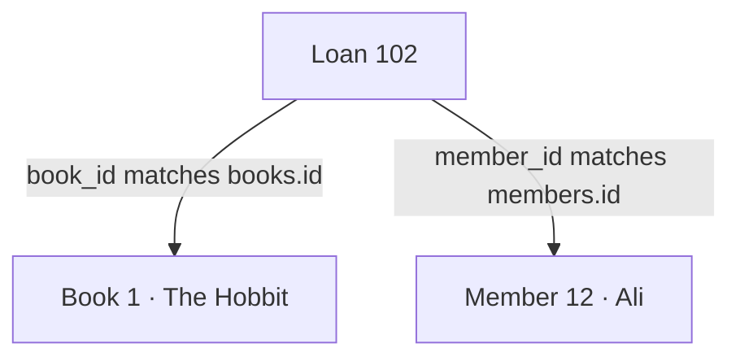
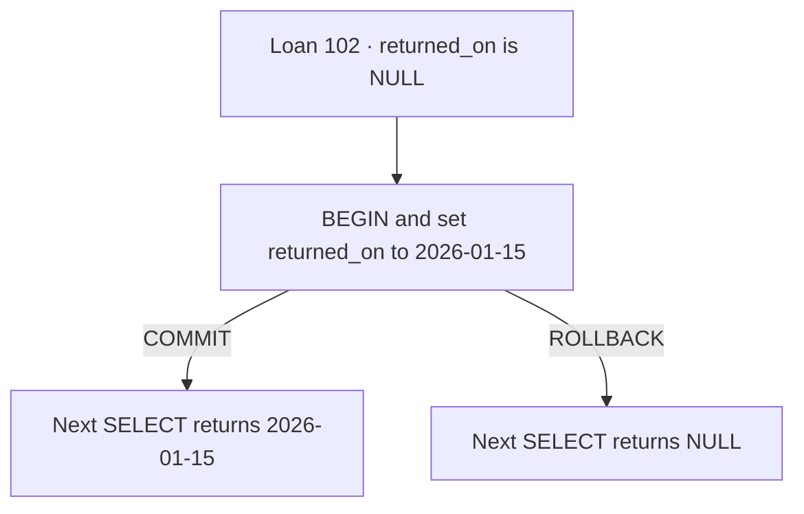

# Session 04 — Join, count, and roll back

[Week 02](README.md) · [Session 03](session-03.md) · [Open postgres.new](https://postgres.new/)

## What we’ll learn

- `INNER JOIN` and `LEFT JOIN`
- `GROUP BY` and `COUNT`
- Transactions, `COMMIT`, and `ROLLBACK`
- SQLAlchemy preview

Use the clean library data from Session 03 or load the [seed script](code/library.sql) into a fresh database. Start by asking which book and member loan `102` points to. In the previous session, we ran three queries to answer that question.

## 1. Match loans with books

```sql
SELECT loans.id, books.title
FROM loans
INNER JOIN books ON loans.book_id = books.id
ORDER BY loans.id;
```

`FROM loans` gives us the starting table. `INNER JOIN books` combines each loan with a matching book. `ON loans.book_id = books.id` gives the rule for matching them. When both tables have an `id` column, the table name in `loans.id` makes clear which ID we want. This query returns three rows. *The Hobbit* appears in two because it was borrowed twice.

## 2. Add the borrower and keep only open loans

```sql
SELECT l.id, b.title, m.name AS borrower
FROM loans AS l
INNER JOIN books AS b ON l.book_id = b.id
INNER JOIN members AS m ON l.member_id = m.id
WHERE l.returned_on IS NULL
ORDER BY l.id;
```

`AS l`, `AS b`, and `AS m` give the tables short names inside this query. The second `INNER JOIN` uses the same pattern as the first. This time, it matches the member ID on a loan to the ID on a member row. `AS borrower` labels the output column. Read `ON` as **how the rows match** and `WHERE` as **which results to keep**.



The result is **loan `102`, The Hobbit, Ali**. Change the filter to show the full loan history for book `1`. You should see both Mina and Ali. [PostgreSQL joins](https://www.postgresql.org/docs/current/tutorial-join.html)

## 3. Count loans for every book, including zero

Predict the counts before writing the query. Start by looking at the rows the database has to work with.

```sql
SELECT b.id, b.title, l.id AS loan_id
FROM books AS b
LEFT JOIN loans AS l ON b.id = l.book_id
ORDER BY b.id, l.id;
```

Compare it with the same query using `INNER JOIN`. *The Little Prince* has no matching loan, so the inner join leaves it out. The left join keeps the book because `books` is on the left. The `loan_id` for that result row is `NULL`.

| Book ID | Book title | Loan ID after `LEFT JOIN` |
|---:|---|---:|
| 1 | The Hobbit | `101` |
| 1 | The Hobbit | `102` |
| 2 | A Wizard of Earthsea | `103` |
| 3 | The Little Prince | `NULL` |

```sql
SELECT b.id, b.title, COUNT(l.id) AS loan_count
FROM books AS b
LEFT JOIN loans AS l ON b.id = l.book_id
GROUP BY b.id, b.title
ORDER BY b.id;
```

`GROUP BY` puts rows for each book in the same group. `COUNT(l.id)` counts the non-`NULL` loan IDs in each group. The output has one row per book.

| Book | Loan count |
|---|---:|
| The Hobbit | 2 |
| A Wizard of Earthsea | 1 |
| The Little Prince | 0 |

**Try it.** Replace `COUNT(l.id)` with `COUNT(*)`. Explain why *The Little Prince* now shows `1`. The left join kept one result row for that book, and `COUNT(*)` counts that row. [PostgreSQL aggregate functions](https://www.postgresql.org/docs/current/tutorial-agg.html)

## 4. Try a change in a transaction

Check the return date on loan `102` before the demo.

```sql
SELECT id, returned_on FROM loans WHERE id = 102;
```

Run this block together. Then run the `SELECT` again.

```sql
BEGIN;

UPDATE loans
SET returned_on = DATE '2026-01-15'
WHERE id = 102;

ROLLBACK;
```

`BEGIN` starts a transaction. `ROLLBACK` discards its changes, so `returned_on` should still be `NULL`. Repeat the block with `COMMIT` in place of `ROLLBACK`. This time the next `SELECT` shows the saved date. After the demo, restore the open loan so the rest of the examples match the original data.



```sql
UPDATE loans SET returned_on = NULL WHERE id = 102;
```

**In an AI service:** Imagine saving one document row and three chunk rows. If the third chunk write fails, a transaction can roll back the document and the earlier chunk writes together. [PostgreSQL transactions](https://www.postgresql.org/docs/current/tutorial-transactions.html)

## 5. Preview SQLAlchemy

These two expressions ask for the same columns in the same order. The Python example uses a `Book` class mapped to the existing `books` table.

```sql
SELECT id, title FROM books ORDER BY id;
```

```python
statement = select(Book).order_by(Book.id)
```

`select(Book)` selects the columns mapped by `Book`, which are `id` and `title`. The Python expression describes the query. A SQLAlchemy session executes it against PostgreSQL. In the homework, you’ll use the same idea to filter open loans in a FastAPI route. [SQLAlchemy ORM Quick Start](https://docs.sqlalchemy.org/en/20/orm/quickstart.html#simple-select)

## Exit check

Which join keeps books with no loans? What does `COUNT(l.id)` count? How would you confirm that a rollback worked?

For another dataset, try [SQLBolt’s first join exercise](https://sqlbolt.com/lesson/select_queries_with_joins). Continue with [Homework 04](assignment04.md).
